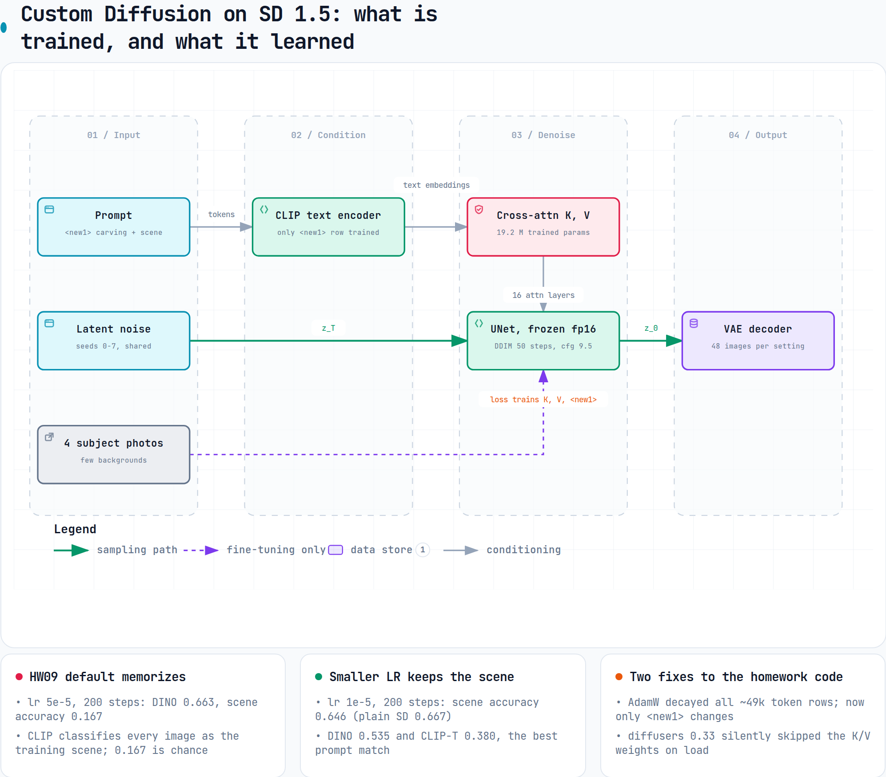

# Custom Diffusion ablation: subject fidelity vs editability

Stable Diffusion 1.5 + Custom Diffusion on the 4-image subject from NTU GenAI-ML 2025 HW09. Compared against BLIP-Diffusion (zero-shot) and plain SD 1.5.

- 4 training configurations × 5 checkpoints.
- 48 images each: 6 scenes × 8 shared seeds.
- Metrics: DINO, CLIP-I and CLIP-T, plus a CLIP 6-way **scene accuracy** that I added.

Full report (in Chinese): [`report/report.md`](report/report.md). Scores are in `out/*/scores.json` and `runs/`.

| Setting | CLIP-T | DINO | Scene acc. (chance 0.167) |
|---|---|---|---|
| SD 1.5, text only | 0.367 | 0.260 | 0.667 |
| BLIP-Diffusion | 0.348 | 0.462 | 0.396 |
| **K/V, lr 1e-5, 200 steps** | **0.380** | 0.535 | **0.646** |
| K/V, lr 5e-5, 200 steps (HW09 default) | 0.332 | 0.663 | 0.167 |
| K/V, lr 5e-5, 800 steps | 0.348 | **0.686** | 0.167 |

- **The homework default memorizes the training backgrounds.** Every image is classified as the training scene, whatever the prompt asks for.
- **DINO rewards that memorization, and CLIP-T barely notices it.** Selecting by DINO alone picks the model that copies the photos.
- **Training Q/K/V/out instead of K/V only makes memorization worse.**
- **Guidance scale cannot recover the scene** once the model has memorized it.

Two issues in the homework code are fixed:
- AdamW weight-decayed every token embedding. Now only the new token is updated.
- diffusers 0.33 `load_attn_procs` silently skips Custom Diffusion weights.

Limitations: one subject, one training seed, and the whole-image metrics are not subject-masked.

## Diagram

What Custom Diffusion trains inside SD 1.5, annotated with the measured results. Interactive HTML: [`docs/diagrams/custom-diffusion.html`](docs/diagrams/custom-diffusion.html).



```bash
uv sync
git clone https://github.com/hsichelin/GenAI-ML-2025-HW9.git data/hw9
uv run python scripts/run_all.py
uv run python scripts/context_acc.py
uv run python scripts/make_figs.py
```
