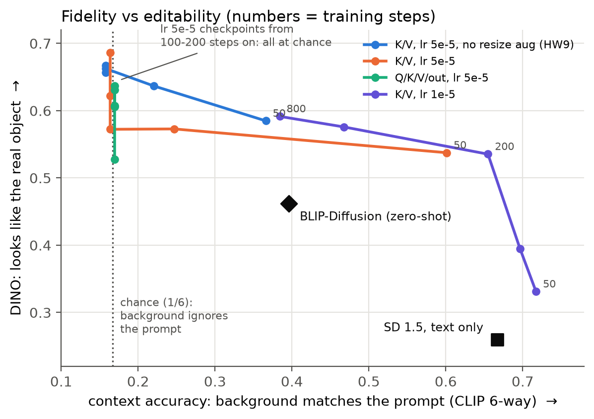
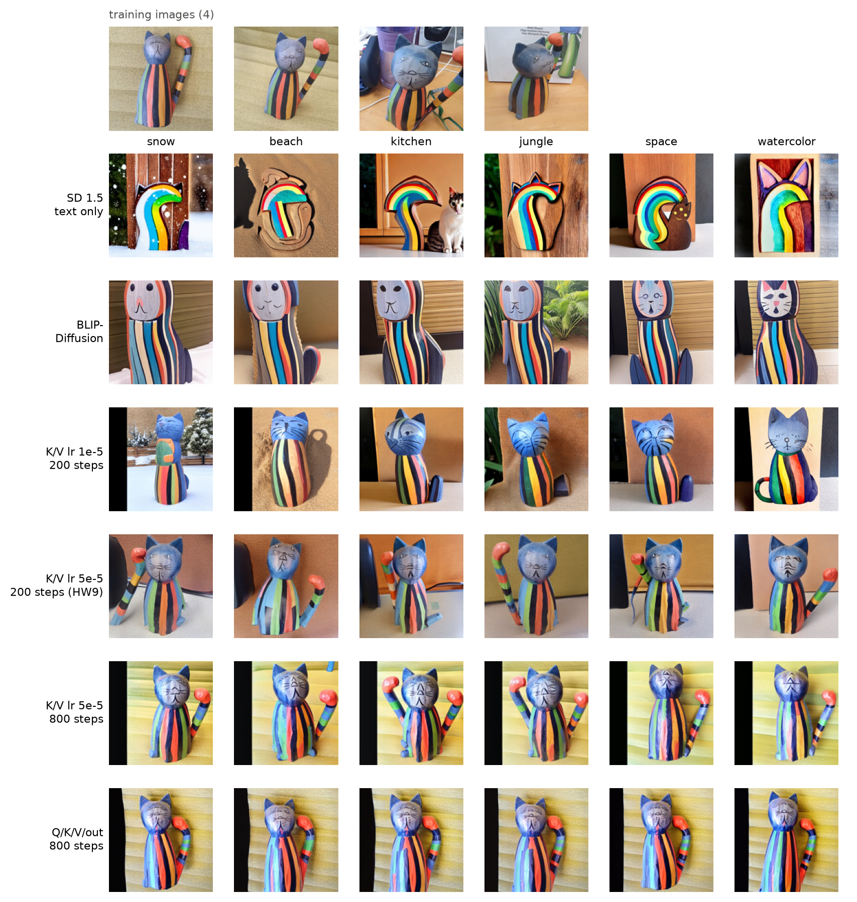
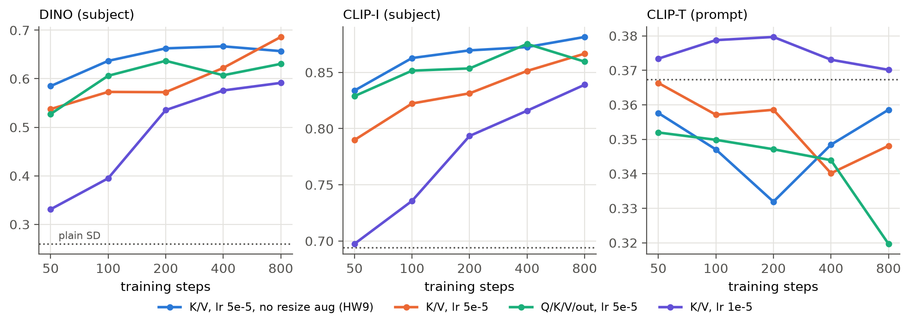
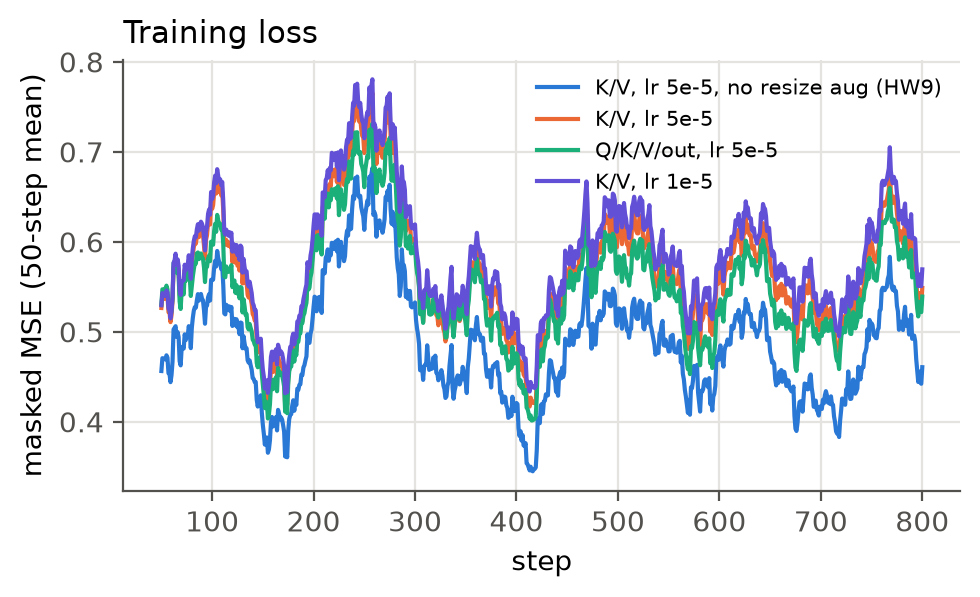
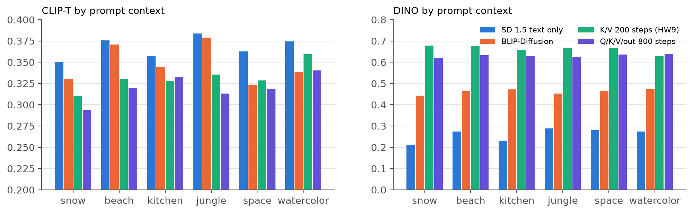
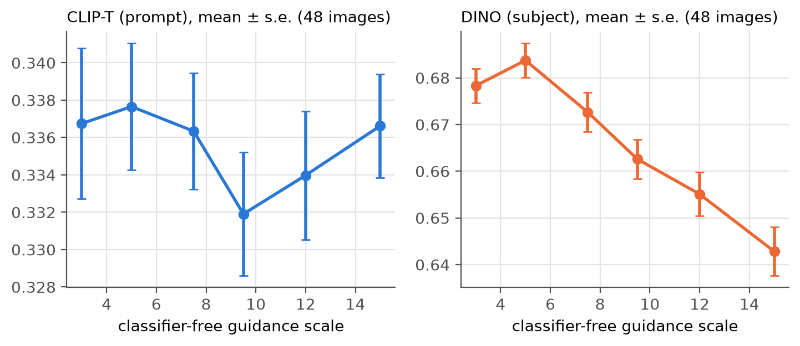

# Custom Diffusion 消融實驗：像不像原物體，與能不能換場景

本專案延伸自「生成式 AI 與機器學習導論 2025」HW09 的 Task 2。

- **模型**：Stable Diffusion 1.5。
- **方法**：Custom Diffusion。新增一個 token `<new1>`，只訓練它的 embedding 和 cross-attention 的投影矩陣。
- **資料**：HW09 提供的 4 張彩色條紋木雕貓。
- **對照組**：同一份作業 Task 2-2 的 BLIP-Diffusion（不需訓練），以及只用文字描述、沒有微調的 SD 1.5。
- **硬體與軟體**：RTX 3060 12 GB；diffusers 0.33.1、transformers 4.50.3，版本和作業一致。

## 0. 設定

**訓練**（每組 800 步，在第 50、100、200、400、800 步各存一個 checkpoint）

| 名稱 | 訓練的參數 | 可訓練參數量 | lr（× batch 2） | resize 增強 |
|---|---|---|---|---|
| K/V, lr 5e-5, no aug（**HW09 原設定**） | cross-attn K、V + `<new1>` | 19.2 M | 5e-5 | 無 |
| K/V, lr 5e-5 | 同上 | 19.2 M | 5e-5 | 有（論文預設） |
| Q/K/V/out, lr 5e-5 | cross-attn Q、K、V、out + `<new1>` | 44.0 M | 5e-5 | 有 |
| K/V, lr 1e-5 | cross-attn K、V + `<new1>` | 19.2 M | 1e-5 | 有 |

- 凍結的 UNet、VAE 以 fp16 執行；可訓練的權重保持 fp32；開啟 gradient checkpointing。每組訓練約 7.5 分鐘，峰值顯存 3.9–4.3 GB。
- **修正 HW09 程式的一個問題**：作業的 AdamW 對整個 token embedding 矩陣做 weight decay。雖然只有 `<new1>` 那一列有梯度，其他約 49,000 個 token 的 embedding 每一步仍會被縮小一點。這裡每一步都把其他列還原。
- **另一個相容性問題**：diffusers 0.33 的 `load_attn_procs` 讀 Custom Diffusion 權重時不會報錯，但其實沒有載入，生成結果等於沒微調。這裡改用作業中的 `_process_custom_diffusion` 載入，並加上 assert 確認 16 個 cross-attention 層都已替換。

**生成**
- 6 種場景（snow、beach、kitchen、jungle、space、watercolor），每種用 seed 0–7 各生成 1 張，每組 48 張。所有設定共用同一組 seed，可以逐張配對比較。
- 取樣器 DDIM，50 步，guidance 9.5（作業預設值）。SD 1.5 每張約 5.4 秒，BLIP-Diffusion（fp32）每張約 16.4 秒。

**指標**
- **DINO**、**CLIP-I**：生成圖和 4 張訓練圖的平均 cosine similarity，衡量「像不像原物體」（DreamBooth 的評估方式）。
- **CLIP-T**：生成圖和 prompt 文字（拿掉 `<new1>`）的 cosine similarity，衡量「是否照 prompt 生成」。
- **context accuracy**（我另外加的）：用 CLIP 把每張圖分類到 6 種場景之一，看分類結果和 prompt 要求的場景是否一致。隨機猜的機率是 1/6 = 0.167。

## 1. 主要結果：fidelity 和 editability 的取捨




| 設定 | CLIP-T | CLIP-I | DINO | context acc. |
|---|---|---|---|---|
| SD 1.5，只用文字 | 0.367 | 0.694 | 0.260 | **0.667** |
| BLIP-Diffusion（不需訓練） | 0.348 | 0.782 | 0.462 | 0.396 |
| **K/V, lr 1e-5, 200 步** | **0.380** | 0.793 | 0.535 | **0.646** |
| K/V, lr 5e-5, 50 步（有 resize 增強） | 0.366 | 0.790 | 0.538 | 0.604 |
| K/V, lr 5e-5, no aug, 200 步（**HW09 原設定**） | 0.332 | 0.870 | 0.663 | 0.167 |
| K/V, lr 5e-5, 800 步 | 0.348 | 0.867 | **0.686** | 0.167 |
| Q/K/V/out, 800 步 | 0.320 | 0.860 | 0.631 | 0.167 |

（48 張圖的標準誤：CLIP-T 約 0.003–0.005，DINO 約 0.004–0.010）

1. **HW09 原設定的生成結果其實不會換場景。** 在 lr 5e-5 下，從第 100–200 步起，context accuracy 就掉到 0.167（隨機程度），所有圖都被分類成 kitchen，也就是訓練照片裡的室內桌面。不管 prompt 寫 snow、beach 還是 space，背景都沒有改變。
2. **DINO 和 CLIP-I 會獎勵這種記憶。** 它們比較的是整張圖，所以背景照抄訓練照片（800 步的結果連黃色沙發都抄了），分數反而更高。分數最高的 K/V 800 步（DINO 0.686），從圖片看完全沒在聽 prompt。**只看 DINO 選設定，會選到記住整張照片的模型。**
3. **CLIP-T 抓不太到這個問題。** context 完全崩潰的設定，CLIP-T 仍有 0.33–0.36，和 SD 1.5 的 0.367 差距不大。CLIP-T 不是不能用，但要配合人工看圖或更直接的指標。
4. **這次最平衡的設定是 lr 1e-5 訓練 200 步**：context accuracy 0.646，接近 SD 1.5 的 0.667；DINO 從 0.26 提高到 0.535；CLIP-T 0.380 是全部設定中最高的。從圖片看，snow、beach、jungle 的背景都有出來，物體也保留藍色頭部和條紋身體。
5. **resize 增強能延後記憶，但無法阻止。** 同樣 lr 5e-5、50 步時，有增強的 context accuracy 是 0.604，沒增強的是 0.375；到 200 步兩者都崩潰了。
6. **多訓練 Q 和 out 投影（參數量 2.3 倍）只會讓情況更糟。** 從第 50 步起就是隨機程度，800 步時 CLIP-T 0.320 是全部最低。這和 Custom Diffusion 論文的主張一致：只訓練 K/V 就夠了。
7. **BLIP-Diffusion 不用訓練**，DINO 0.462 介於 SD 和微調之間，context accuracy 0.396。它在 DINO 和 context 兩項都輸給 lr 1e-5 / 200 步；優點是零訓練成本。

## 2. 訓練步數的影響




- DINO 和 CLIP-I 隨步數上升，lr 越大升得越快。lr 1e-5 到第 200 步，DINO 才明顯超過 BLIP-Diffusion。
- 訓練 loss 看不出明顯的下降趨勢。四條曲線一起起伏，是因為每個 run 用同一個 seed，抽到的 timestep 也一樣，loss 的波動主要反映 timestep，不是學習進度。所以**看 loss 判斷不了何時開始過度記憶**，必須看生成結果。

## 3. 各場景的拆解



- 每一種場景下，微調模型的 DINO 都比 SD 1.5 高：lr 5e-5 的設定高 0.34–0.47，lr 1e-5 / 200 步高 0.22–0.33。
- lr 5e-5 的設定在 jungle、snow、beach 這些需要整片背景改變的場景，CLIP-T 掉得最多（−0.04 到 −0.07）。lr 1e-5 / 200 步除了 space（−0.017）以外，CLIP-T 都不低於 SD 1.5。
- space 在所有設定（包括 SD 1.5）的 context accuracy 都是 0，可能是 CLIP 分類器或 SD 1.5 本身對這個 prompt 的限制，不能單獨歸咎於微調。

## 4. Guidance scale（HW09 原設定，200 步）



- guidance 從 5 調到 15，DINO 從 0.684 穩定降到 0.643（每點標準誤約 0.004）。
- CLIP-T 的變化（0.332–0.338）都在約 2 個標準誤以內，看不出差別。
- context accuracy 全部在 0.17–0.19。**模型已經過度記憶時，再怎麼調 guidance 也救不回場景**，問題出在訓練，不在取樣。

## 5. 結論

1. **評估 personalization 不能只看 subject fidelity 的指標。** DINO 和 CLIP-I 會獎勵連背景一起記住，CLIP-T 又不夠敏感。這次加的 context accuracy 很簡單（CLIP 6 類分類），卻能直接看出模型有沒有照 prompt 換場景。
2. **作業的預設值（lr 5e-5 × batch 2、200 步）在這組資料上會過度記憶。** lr 降到 1e-5、維持 200 步，在兩個目標之間取得最好的平衡。
3. **訓練越少參數越好**：只訓練 K/V 加上 token，比連 Q 和 out 一起訓練更不容易記住背景。

## 限制

- 只測一個物體（4 張圖），每組 48 張圖，訓練只跑一個 seed。
- context accuracy 依賴 CLIP 的 zero-shot 分類，space 在所有設定都是 0，可見這個分類器不是每個場景都可靠。
- DINO 和 CLIP-I 沒有先把物體切出來，比的是整張圖，所以會受背景影響（這正是第 1 節要指出的偏差）。
- 沒有做 DreamBooth 那種 prior preservation（用同類圖片做正則化）；HW09 也沒有使用。

## 重現

```bash
cd ~/diffusion-custom && uv sync
git clone https://github.com/hsichelin/GenAI-ML-2025-HW9.git data/hw9
uv run python scripts/run_all.py            # train → generate → score
uv run python scripts/context_acc.py
uv run python scripts/make_figs.py
```
